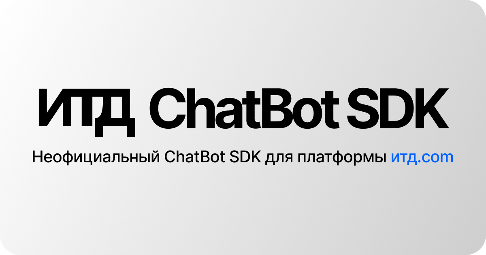

<p align="center">
  <a href="https://pypi.org/project/itd-chatbot-sdk/"></a>
  <a href="https://pypi.org/project/itd-chatbot-sdk/"></a>
  <a href="https://github.com/itd-social/CHATBOT-SDK/blob/main/LICENSE"></a>
</p>

<p align="center">
Python SDK для создания чат-ботов в мессенджере ИТД.
</p>

## Что умеет SDK

- Получать сообщения и события, обрабатывать команды `/start` и другие.
- Отмечать входящие сообщения прочитанными и показывать "печатает" во время обработки.
- Отправлять и редактировать сообщения, работать с форматированием, реакциями и файлами.
- Поддерживать сессию через refresh-cookie с автоматическим обновлением access-токена.
- Распределять запросы по времени с общей защитой и отдельными паузами для сообщений.

SDK использует API веб-клиента ИТД и работает от имени пользовательского аккаунта. Это неофициальный проект: права, ограничения и формат событий определяются сервером ИТД. Возможности и ограничения описаны в [документации](docs/USAGE.md).

## Установка

Поддерживаемые версии Python указаны в значке выше:

```sh
python -m pip install itd-chatbot-sdk
```

Для работы с WebSocket:

```sh
python -m pip install "itd-chatbot-sdk[websocket]"
```

## Быстрый старт

Сначала получите cookie `refresh_token` аккаунта бота и задайте её в переменной `ITD_REFRESH_TOKEN`. [Как получить токен?](docs/AUTH.md#как-получить-refresh_token)

```python
import os

from itd_bot import Bot, Dispatcher

with Bot.from_refresh_token(os.environ["ITD_REFRESH_TOKEN"]) as bot:
    profile = bot.api_request("GET", "/api/users/me")
    router = Dispatcher(bot, self_user_id=profile["id"])

    @router.command("start")
    def start(ctx):
        ctx.reply("Привет! Напишите /echo и текст.")

    @router.command("echo")
    def echo(ctx):
        ctx.reply(ctx.args or "Добавьте текст после команды")

    cursor = bot.get_chats(limit=1)["event_seq"]
    router.run_polling(since=cursor)
```

Для минимальной задержки ответа установите extra `[websocket]` и вызовите `router.run_polling(since=cursor, websocket=True)`: бот запросит события сразу после сигнала сервера, а не по таймеру. На живом ИТД этот режим не проверялся; если сервер не присылает кадр на новое сообщение, бот работает как при обычном опросе. Параметр `workers=4` обрабатывает разные чаты параллельно, поэтому общее изменяемое состояние в обработчиках нужно защищать блокировками.

Этот пример начинает с текущего события и пропускает старые сообщения. Он не сохраняет курсор между запусками. Для настоящего бота сохраняйте курсор после успешной обработки пакета и учитывайте повторную доставку: [пошаговый пример](docs/GETTING_STARTED.md).

`Bot.from_refresh_token` по умолчанию сохраняет актуальный токен в `.itd-session.json`. Файл содержит секрет в открытом виде — защитите его и не добавляйте в Git. Сессия может истечь или быть отозвана; [подробнее об авторизации](docs/AUTH.md).

## Примеры

Каждый пример лежит в своей папке с коротким README. Токены задаются переменными окружения, значений по умолчанию нет.

- [rate_limit_demo](examples/rate_limit_demo/README.md): офлайн-показ корзин токенов и пауз после 429.
- [formatting_bot](examples/formatting_bot/README.md): форматирование через `Text`.
- [countdown_bot](examples/countdown_bot/README.md): отправка, правка и удаление своего сообщения.
- [reactions_bot](examples/reactions_bot/README.md): постановка реакций и событие `reaction`.
- [media_saver](examples/media_saver/README.md): сохранение вложений входящих сообщений.
- [forward_bot](examples/forward_bot/README.md): пересылка сообщений в служебный чат.
- [subscribers_only](examples/subscribers_only/README.md): команда только для подписчиков.
- [profile_lookup](examples/profile_lookup/README.md): чтение профиля пользователя.

Плоские примеры `examples/echo.py`, `commands.py` и `chat_actions.py` остались на месте.

## Документация

| Раздел | Что внутри |
|---|---|
| [Первый бот](docs/GETTING_STARTED.md) | Установка, команды, получение ID и сохранение курсора |
| [Ограничения запросов](docs/RATE_LIMITS.md) | Настройки общей защиты, очереди сообщений и обработка 429 |
| [Авторизация](docs/AUTH.md) | Получение refresh-cookie, ротация и восстановление сессии |
| [Руководство](docs/USAGE.md) | Сообщения, события, файлы, реакции и форматирование |
| [Справочник API](docs/API_REFERENCE.md) | Методы клиента, обработчики и ошибки |
| [Примеры](examples/) | Эхо-бот, команды, тестовые боты и небольшие боты по темам |
| [История изменений](CHANGELOG.md) | Изменения по выпущенным версиям |
| [Публикация в PyPI](docs/PUBLISHING.md) | Как выпустить пакет для установки через pip |

## Разработка

```sh
python -m pip install -e ".[dev]"
python -m ruff check itd_bot examples tests
python -m ruff format --check itd_bot examples tests
python -m pytest -q
python -m build
```

Тесты выполняются без настоящих токенов и подключения к ИТД. Процесс разработки и чеклист — в [dev.md](dev.md), ветки и коммиты — в [GIT_WORKFLOW.md](GIT_WORKFLOW.md), выпуск версии — в [RELEASING.md](RELEASING.md).

## Лицензия

Проект распространяется по [Apache License 2.0](LICENSE).
