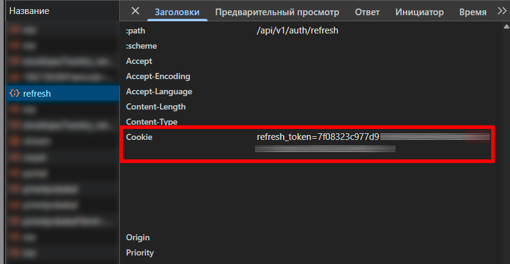

# Авторизация

Чтобы бот работал долго, ему нужна `refresh_token` cookie. По ней SDK сам получает короткоживущие access-токены и обновляет их, пока вы занимаетесь делами.

## Как получить refresh_token

1. Откройте окно браузера в режиме инкогнито и войдите в аккаунт **бота**.
2. Откройте инструменты разработчика и найдите cookies сайта ИТД (раздел Application, Storage или Cookies).
3. Скопируйте **значение** cookie `refresh_token`, без имени и без `=`.
4. Сразу закройте окно инкогнито, не выходя из аккаунта и ничего не нажимая на сайте. Так браузер не обновит сессию, и скопированное значение останется рабочим.
5. Положите значение в переменную окружения `ITD_REFRESH_TOKEN`.



> **Подсказка.** Если смотрите cookie во вкладке Network (запрос `/api/v1/auth/refresh`), помните: там может лежать уже устаревшее значение. Для запуска берите актуальное из хранилища cookies и не делайте новый `/refresh` ради поиска токена.

## Подключение

```python
import os
from itd_bot import Bot

with Bot.from_refresh_token(os.environ["ITD_REFRESH_TOKEN"]) as bot:
    print(bot.get_me().username)
```

Дальше SDK всё делает сам:

- обновляет access-токен, когда до конца срока остаётся 30 секунд или меньше;
- при ответе 401 обновляет сессию и один раз повторяет запрос (кроме загрузки файлов multipart);
- сохраняет новую refresh-cookie, если сервер её сменил.

Если при сетевом сбое неясно, выполнилась ли операция записи, SDK её **не повторяет**. Решение за вами.

Нужен просто короткий токен для эксперимента? `Bot("ACCESS_TOKEN")` принимает его без слова `Bearer`, но он быстро истекает.

## Хранение и ротация

Чтобы читать токены и настройки из окружения одним вызовом, используйте [Bot.from_env()](ENVIRONMENT.md). SDK не открывает `.env` автоматически; при необходимости загрузите его явно через необязательное дополнение `[env]`.

По умолчанию SDK создаёт файл `.itd-session.json` рядом с запуском и записывает туда актуальную refresh-cookie. При следующем запуске используйте ту же переменную `ITD_REFRESH_TOKEN` и тот же путь: бот возьмёт сохранённое значение.

```python
Bot.from_refresh_token(token, session_path="secrets/bot.json")  # свой путь
Bot.from_refresh_token(token, session_path=None)                # только в памяти
```

Что важно:

- Файл содержит токен в открытом виде. Не коммитьте его и храните в защищённой папке. Стандартные имена уже есть в `.gitignore`, свои пути добавьте сами.
- Другой токен с тем же путём приведёт к `SessionStorageError`. Для другого бота используйте другой файл.
- В режиме `session_path=None` после перезапуска первоначальная cookie может уже не подойти, потому что сервер её сменил.

## Правила безопасной работы

- Одна refresh-сессия, один процесс. Между процессами SDK ничего не синхронизирует.
- Не открывайте ту же сессию в браузере, пока работает бот.
- Если процесс упал в момент обновления, сервер мог уже выдать новый токен, а бот не успел его сохранить. Тогда понадобится новая cookie.
- SDK читает JWT только ради срока действия и не проверяет подпись. Не используйте его для проверки прав пользователей.

## Бот для проверки на час

В [`examples/refresh_test_bot.py`](../examples/refresh_test_bot.py) лежит бот, который отвечает на сообщения и показывает счётчик обновлений токена. Удобно, чтобы убедиться, что сессия живёт дольше одного access-токена.
